# photonring

A real-time WebGPU renderer of a non-rotating black hole that checks its own physics against analytic values and a 64-bit reference renderer, and publishes the measured errors.

This is a toy model for learning and demonstration, not a scientific simulation of any real observation.


_The page's opening view (30 M from the hole, 12 degrees above the disk, 60 degree field of view), rendered by the CPU reference renderer in 64-bit floats at 1600 x 900 with 3 x 3 samples per pixel (`npm run render:hero`). The page draws the same view live on the GPU: it is the view the page opens with, and `#v=1&r=30&az=0&el=12&disk=1&aa=1&view=colour&ov=none&val=0` at the end of the address returns to it._

**Live page:** not deployed yet.

**Contents:** [Gallery](#gallery), [The page](#the-page), [How it works](#how-it-works), [What is validated](#what-is-validated), [Run it locally](#run-it-locally).

## Run it locally

```bash
git clone https://github.com/Waiivyy/photonring.git && cd photonring
npm install
npm run dev
```

Then open `http://localhost:5179` in a browser with WebGPU (see [Browser support](#browser-support)). Needs Node 22.18 or later.

## Gallery

Rendered by the CPU reference renderer in 64-bit floats (`npm run render:readme`; the two
labelled images by `npm run shots:readme`, which draws their labels with the page's own Save image
code). The settings of every image are in the tools (`tools/readme-views.ts`).

<table>
<tr>
<td width="50%"><br><b>EHT-style view</b> (false colour), at the preset "Tilt 17°, as for M87*": the toy disk at the 2019 EHT resolution, scaled to this hole. Not what M87* looks like: see <a href="#the-eht-style-view">The EHT-style view</a>. On the page: <code>#v=1&amp;r=200&amp;az=0&amp;el=-73&amp;disk=1&amp;aa=1&amp;view=eht&amp;ov=none&amp;val=0</code></td>
<td width="50%">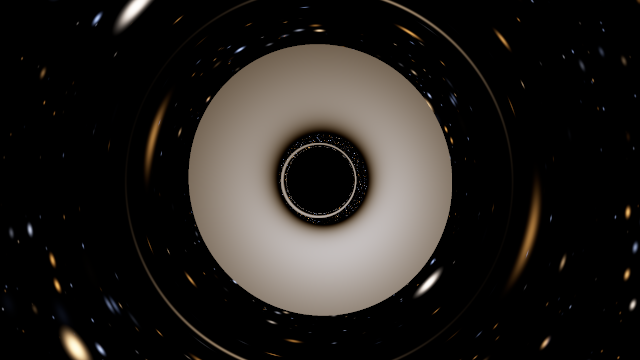<br><b>The same camera in colour</b>: the blackbody colours of the disk, same framing and turn as the EHT-style view, so the two images can be compared. The page opens this orbit in the colour view with its usual framing.</td>
</tr>
<tr>
<td>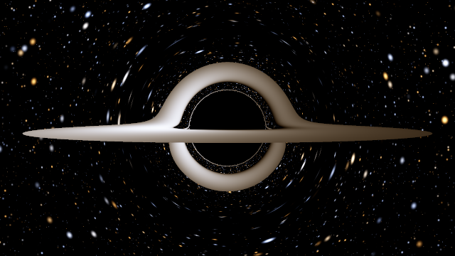<br><b>Nearly edge-on</b>, 2 degrees above the disk: the far side of the disk is lifted into an arch by the bent light.</td>
<td>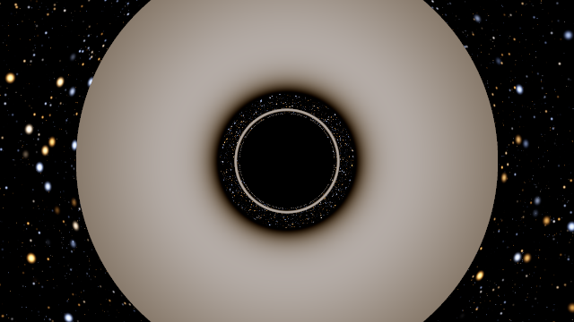<br><b>Face-on</b>, 90 degrees above the disk: the thin ring just outside the shadow is the disk's second image.</td>
</tr>
<tr>
<td>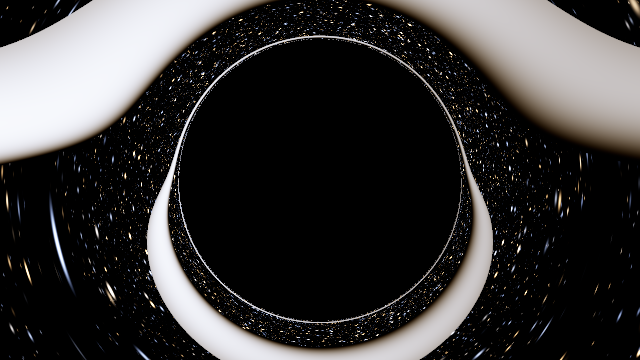<br><b>Close</b>, 5 M from the hole: the field of view widens by itself to 120 degrees so the shadow fits.</td>
<td>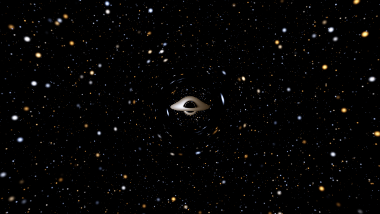<br><b>Far</b>, 200 M from the hole, at the page's usual 60 degree field of view.</td>
</tr>
<tr>
<td>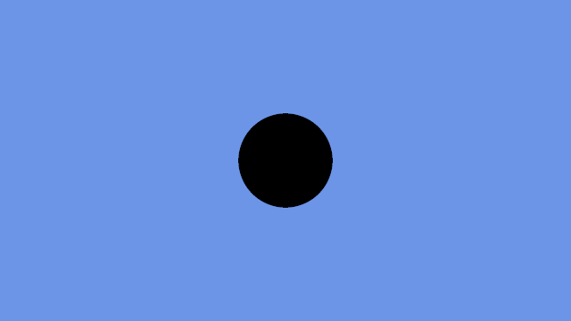<br><b>Termination view</b> (debug): each pixel coloured by how its ray ended, captured or escaped; no ray reached the step limit.</td>
<td>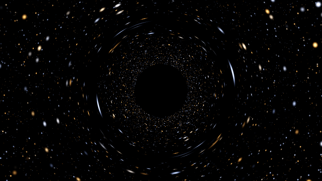<br><b>No disk</b>: the shadow and the star field behind it, bent into arcs and double images near the edge.</td>
</tr>
</table>


_**Photon subrings**, magnified and on a logarithmic scale: not what a camera sees. The region just
outside the shadow edge, unrolled once round the image (across) and stretched so that the distance
from the edge, ε = b/b<sub>c</sub> - 1, runs down on a logarithmic scale; face-on at 30 M, 64-bit
CPU render. Band n is the image of the disk made by light that circled the hole n more
half-turns; the lines are its edges as the 64-bit library predicts them. Each band is about
e<sup>π</sup> ≈ 23 times closer to the edge than the one before, as Gralla, Holz and Wald (2019)
and Johnson et al. (2020) predicted: photonring reproduces this with its own code; it is not a
discovery. The dashed line marks where the GPU page's 32-bit arithmetic stops resolving the bands
(measured on an Apple M5); this 64-bit render resolves them below it._

Computed by the 64-bit library, face-on at 30 M, for the disk's inner edge (6 M) and outer edge
(20 M); measured on the GPU (WGSL, 32-bit) by fans of rays across each edge, Apple M5, Chrome
156.0.8078.80, 2026-11-05 (`tests/gpu/subrings.spec.ts`):

| Subrings | $\varepsilon_n / \varepsilon_{n+1}$ at 6 M | at 20 M | GPU-measured, at 6 M          |
| -------- | ------------------------------------------ | ------- | ----------------------------- |
| 1 to 2   | 23.6451                                    | 26.2983 | 23.6447                       |
| 2 to 3   | 23.2018                                    | 23.3375 | 23.1512                       |
| 3 to 4   | 23.1449                                    | 23.1524 | too close to the 32-bit limit |
| 4 to 5   | 23.1409                                    | 23.1413 |                               |

$e^\pi = 23.1407$. The GPU locates the band edges within $2.0\times10^{-7}$ of the 64-bit
values at 30 M, so its ratio from 1 to 2 agrees to 0.002 % and from 2 to 3 to 0.22 %; over 5, 30 and
200 M and three view directions, within 0.045 % and 1.44 %.

## The page

Screenshots of the running page (`npm run shots:readme`), headless Google Chrome 156.0.8078.80 on
an Apple M5 at device pixel ratio 1 (the two panel crops at 2). The status lines show the GPU
times of the moment each was taken; they depend on how busy the GPU has been
([docs/PERFORMANCE.md](docs/PERFORMANCE.md#what-the-pages-status-line-measures-stage-7)).

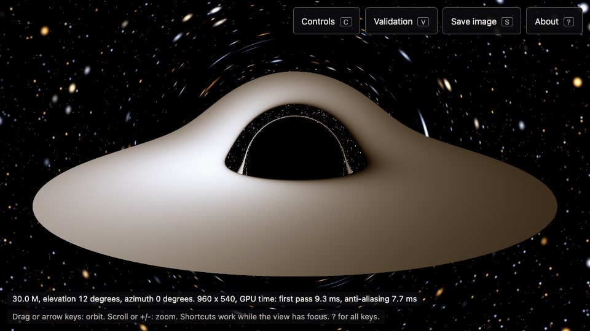

<table>
<tr>
<td width="50%">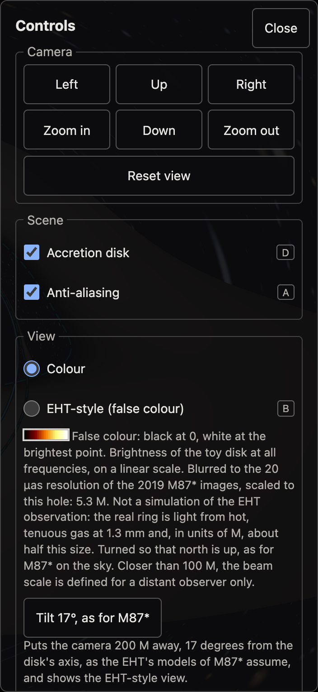<br>The Controls panel: every action as a button, checkbox or radio button.</td>
<td width="50%">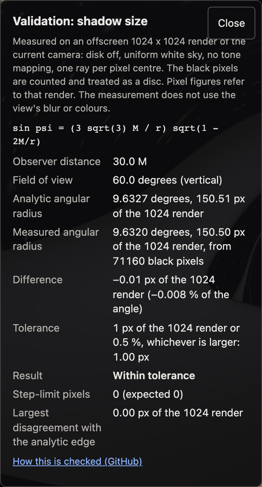<br>The Validation panel: the shadow radius measured on an offscreen render of the current camera against the analytic value.</td>
</tr>
</table>

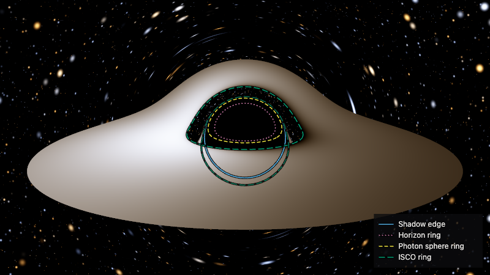

_The page's Save image with every overlay on: the shadow edge and where the circles at 2 M, 3 M and
6 M in the disk's plane appear through the bent light, with their legend._

<table>
<tr>
<td width="50%">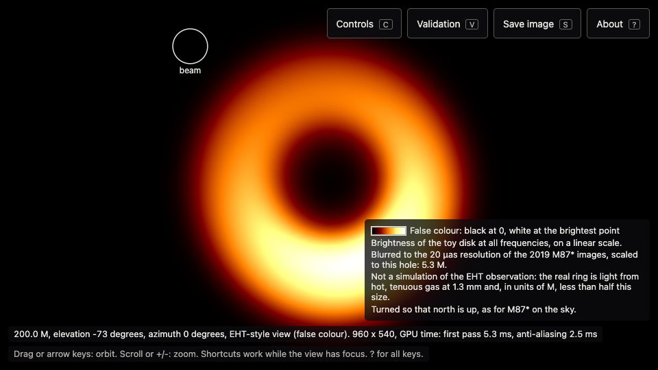<br>The EHT-style view on the page (key <code>B</code>), with its labels.</td>
<td width="50%">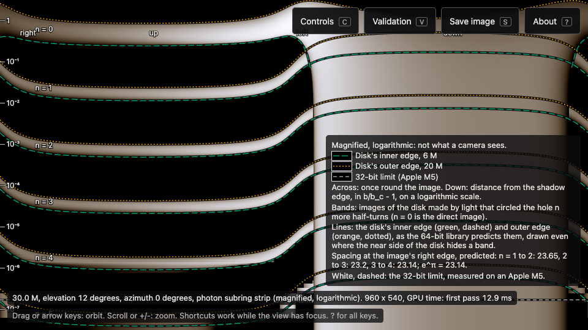<br>The photon subring view (key <code>N</code>) in the default camera: the near side of the disk hides the bands over the lower half of the image (the right half of the strip).</td>
</tr>
</table>

## Browser support

photonring needs WebGPU. Without it the page explains why, lists the browsers where WebGPU is on by default (a short form of the table below) and shows four images made by the CPU reference renderer; there is no WebGL fallback.

**Where WebGPU is on by default**, checked on 2026-11-02 against [MDN browser-compat-data](https://github.com/mdn/browser-compat-data), the [gpuweb implementation-status wiki](https://github.com/gpuweb/gpuweb/wiki/Implementation-Status) and the vendors' release notes, blogs and bug trackers (every source: [docs/DESIGN.md](docs/DESIGN.md), section 4). This is what the vendors state, not a test of this page:

| Browser                             | WebGPU                                                                                                                                                               |
| ----------------------------------- | -------------------------------------------------------------------------------------------------------------------------------------------------------------------- |
| Chrome, Windows, macOS and ChromeOS | Since 113 (ChromeOS: devices with Vulkan; Windows on ARM64: behind a flag, per the wiki)                                                                             |
| Edge, Windows and macOS             | Since 113 (Edge has no ChromeOS version; no Microsoft page found on WebGPU on Linux)                                                                                 |
| Chrome, Linux                       | Since 144 with Intel Gen12 or newer GPUs (rolled out gradually), since 147 with recent NVIDIA drivers under Wayland (per the wiki); other GPUs behind flags          |
| Chrome, Android                     | Since 121 on Android 12 or later with Qualcomm or ARM GPUs, since 139 on Android 16 or later with Imagination GPUs (per the wiki); not yet with Samsung Xclipse GPUs |
| Safari                              | Safari 26 or later, on macOS Tahoe 26, iOS 26, iPadOS 26, visionOS 26 and later versions; not on macOS Sequoia or Sonoma, and off in Lockdown Mode                   |
| Firefox, Windows                    | Since 141                                                                                                                                                            |
| Firefox, macOS                      | Apple silicon only: since 145 on macOS Tahoe, since 147 on older macOS                                                                                               |
| Firefox, Linux and Android          | Not shipped (Nightly or flags only)                                                                                                                                  |

<details><summary><b>What photonring was run on</b> (every automated run is headless)</summary>

| Browser                                                                                                                                                                                                                                                      | Machine; WebGPU adapter                                                      | What ran                                                                                | Result                                                                                                                                                                                                                                                                                                                                                                                                         |
| ------------------------------------------------------------------------------------------------------------------------------------------------------------------------------------------------------------------------------------------------------------ | ---------------------------------------------------------------------------- | --------------------------------------------------------------------------------------- | -------------------------------------------------------------------------------------------------------------------------------------------------------------------------------------------------------------------------------------------------------------------------------------------------------------------------------------------------------------------------------------------------------------- |
| Google Chrome 156 (156.0.8078.47 in the Stage 2 benchmark; 156.0.8078.48 in the later benchmarks and the GPU re-run at commit 0123428; 156.0.8078.74 in the GPU re-run at commit afd9fd5; 156.0.8078.80 for the Stage 7 tests, benchmarks and README images) | Apple M5, macOS 27.0; Metal                                                  | Every test suite, the benchmarks and the check-in renders                               | Pass                                                                                                                                                                                                                                                                                                                                                                                                           |
| Google Chrome 156                                                                                                                                                                                                                                            | Apple M5, macOS 27.0; SwiftShader (software)                                 | The offline test of the built page                                                      | Pass                                                                                                                                                                                                                                                                                                                                                                                                           |
| Google Chrome 152.0.7977.83                                                                                                                                                                                                                                  | GitHub `macos-15` runner, arm64; Apple paravirtual GPU, no `timestamp-query` | The 13 GPU tests of Stage 5 and the page tests on the build                             | Passed in all 13 of the first 17 runs on 2026-10-28 in which the job started; in the other 4 GitHub assigned no runner and cancelled the job                                                                                                                                                                                                                                                                   |
| Google Chrome 155.0.8059.39 and 156.0.8078.47                                                                                                                                                                                                                | GitHub `ubuntu-24.04` runner; SwiftShader (software)                         | The offline test and the 14 smoke tests on the build; the full page suite once, by hand | Passed in both runs after the wait for SwiftShader went from 20 s to 60 s (as recorded at Stage 5); before that, the first run lost the WebGPU device until Chrome got its own Vulkan driver, and slow runners missed the 20 s wait. Full suite: 108 of 109; one save gave up because the image was not complete within the page's 10 s (9.2 to 9.6 s of GPU time alone; the wall-clock time was not measured) |

</details>

Not tested: Safari, Firefox (not installed on the development machine), Edge, and Chrome on Windows, on Linux GPUs or on Android. Touch control and the phone layout were tested only in Chrome's mobile emulation (390 x 844 CSS px), not on a real phone or tablet, and no screen reader has been tried by hand.

## Controls

Drag to orbit; scroll or pinch to zoom. Keys work while the view has focus (click it or Tab to it), and every action is also a button or checkbox on the page: in the toolbar, in the Controls panel or, for `Escape`, the Close button of a panel or of the About dialog.

| Action                                                                                                                           | Keys               |
| -------------------------------------------------------------------------------------------------------------------------------- | ------------------ |
| Orbit, 5 degrees per press                                                                                                       | Arrow keys         |
| Zoom in, zoom out                                                                                                                | `+` or `=`, `-`    |
| Accretion disk, anti-aliasing                                                                                                    | `D`, `A`           |
| Views: EHT-style (false colour), photon subrings (magnified), termination (debug); the same key again returns to the colour view | `B`, `N`, `T`      |
| Overlays: shadow edge, horizon, photon sphere, ISCO                                                                              | `E`, `H`, `P`, `I` |
| Controls panel, Validation panel                                                                                                 | `C`, `V`           |
| Save the image as PNG                                                                                                            | `S`                |
| Reset the view                                                                                                                   | `R` or `Home`      |
| About, with every key                                                                                                            | `?`                |
| Close the last opened panel                                                                                                      | `Escape`           |

The camera stays between 5 M and 200 M from the hole, where M is the black hole's mass in geometric units (G = c = 1). The view is kept in the part of the address after `#`, so a copied link opens the same view.

## How it works

Every equation here is derived, with its source, in [docs/PHYSICS.md](docs/PHYSICS.md); every
number on a diagram is computed by the library when the diagram is drawn (`npm run diagrams`).
The diagrams draw $r$ and $\phi$ as flat polar coordinates, the usual textbook picture: lengths
and angles on the page are not what a local observer measures.


**The names used everywhere.** The event horizon at $r = 2M$; the photon sphere at $r = 3M$, where
light can circle the hole; the innermost stable circular orbit (ISCO) at $r = 6M$, where the toy
disk ends; and the critical impact parameter $b_c = 3\sqrt3 M \approx 5.196\thinspace M$, the aim that
separates light that falls in from light that escapes. $M$ is the black hole's mass in geometric
units ($G = c = 1$).

### Light bends


With the conserved energy $E$ and angular momentum $L$ of a photon, $b = L/E$ and $u = 1/r$, the
orbit equation of the Schwarzschild metric is

```math
\left(\frac{du}{d\phi}\right)^2 = \frac{1}{b^2} - u^2\,(1 - 2Mu),\qquad
\frac{d^2u}{d\phi^2} + u = 3Mu^2 .
```

A ray turns back where $1/b^2 = V(r) = (1 - 2M/r)/r^2$; $V$ peaks at $r = 3M$ with
$V = 1/(27M^2)$, so rays aimed with $b < b_c = 3\sqrt3 M$ never turn and fall in. The deflection is
$\alpha(b) = 2\int_0^{u_2} du/\sqrt{P(u)} - \pi$, with $P$ the right-hand side above and $u_2$ the
turning point: about $4M/b$ far away, and much more near $b_c$ (41.3 degrees at $1.7\thinspace b_c$, where
$4M/b$ gives 25.9). photonring computes it two independent ways (Gauss-Legendre quadrature and
Carlson elliptic integrals) and the GPU integrates the second form with Runge-Kutta steps in
$\phi$. Details: [docs/PHYSICS.md](docs/PHYSICS.md), sections 2 and 8.

### The shadow is larger than the horizon


A static observer at $r_o$ sees a ray of impact parameter $b$ at the angle $\psi$ from the
direction to the hole with

```math
\sin\psi = \frac{b}{r_o}\sqrt{1 - \frac{2M}{r_o}},
```

so the shadow's edge, the rays with $b = b_c$, is at $\sin\psi_{sh} = (b_c/r_o)\sqrt{1 - 2M/r_o}$:
27.69 degrees at 10 M and 9.633 degrees at 30 M, against 31.31 and 9.974 degrees for straight
lines. Every ray aimed inside reaches the photon sphere and the horizon, so the edge is also the
apparent outline of both. Details: [docs/PHYSICS.md](docs/PHYSICS.md), sections 6 and 6a.

### Rings inside rings: photon subrings


Near the critical ray, a small offset $\delta u$ from the photon sphere obeys
$\delta u'' = \delta u$ and grows as $e^\phi$: each half-turn of the orbit, $\Delta\phi = \pi$,
multiplies it by $e^\pi \approx 23.14$. So rays aimed ever closer to the edge circle the hole once,
twice and more before they meet the disk, and each extra half-turn gives another image of the disk,
$e^\pi$ times closer to the edge. Bozza's (2002) strong-field law
$\alpha(b) = -\ln(b/b_c - 1) + \ln[216(7 - 4\sqrt3)] - \pi + \dots$ makes this exact for rays from
infinity. For a camera at $r_o$ and a disk ring at $R$, the law of Bozza and Scarpetta (2007) for a
source and an observer at finite distances, which Aldi and Bozza (2017) applied to the images of a
disk and Bisnovatyi-Kogan and Tsupko (2022), Tsupko (2022) and Aratore, Tsupko and Perlick (2024)
to its rings, gives for the sweep $\phi_0 + n\pi$ to the image of order $n$

```math
\varepsilon_n(R) \approx C\,e^{-\Delta\phi_c(1/r_o) - \Delta\phi_c(1/R)}\,e^{-\phi_0}\,e^{-n\pi},\qquad
C = 216(7 - 4\sqrt3),
```

where $\varepsilon = b/b_c - 1$, $\Delta\phi_c(u)$ is the critical orbit's sweep from infinity to
$u$ and $\phi_0$ where the ray first meets the disk's plane: their law, written with
$\Delta\phi_c$. photonring starts from it and solves the exact equation for any $n$ with its
64-bit library: the ratios in the [Gallery](#gallery) table, converging on $e^\pi$ as Gralla, Holz
and Wald (2019) and Johnson et al. (2020) published. Details: [docs/PHYSICS.md](docs/PHYSICS.md),
section 6b.

### One side is brighter

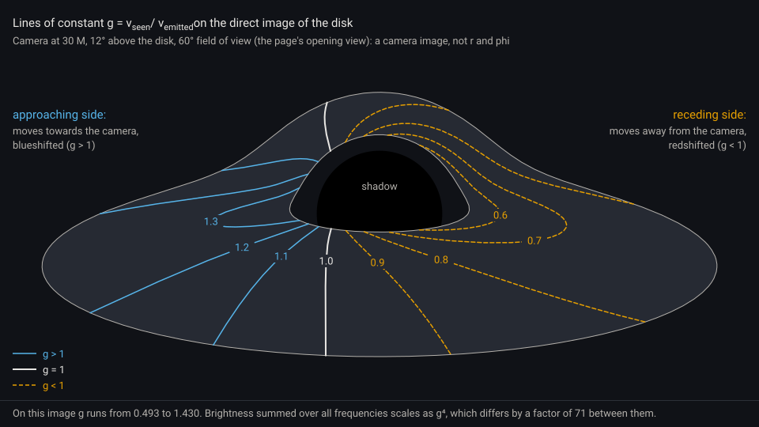

The disk's gas orbits at $\Omega = \sqrt{M/r^3}$. Light from it reaches the camera with its
frequency multiplied by

```math
g = \frac{1}{u^t\,(1 - \Omega\,L_z/E)}\,\frac{1}{\sqrt{1 - 2M/r_o}},\qquad u^t = \frac{1}{\sqrt{1 - 3M/r}},
```

where $L_z/E$ is the photon's: Doppler shift and gravitational redshift together. A blackbody at
temperature $T$ looks like one at $gT$, and since $I_\nu/\nu^3$ is conserved along a ray, its
brightness summed over all frequencies scales as $g^4$: a factor of 71 between the two ends of the
range in this image. The temperature profile is the toy's $T(r) \propto r^{-3/4}(1 - \sqrt{r_{in}/r})^{1/4}$,
hottest at $(49/36)\thinspace r_{in}$. Details: [docs/PHYSICS.md](docs/PHYSICS.md), sections 9 and 10.

### The EHT-style view

Asked for as "how the ring actually looks": how this toy disk would look at the resolution of the
2019 Event Horizon Telescope images of M87*, in their kind of false colour. It shows the disk's
brightness summed over all frequencies, $(g\hat T)^4$, blurred with a circular Gaussian of the
20 μas resolution of those images (EHT Collaboration 2019, Paper I, section 5) scaled by M87*'s mass
scale $\theta_g = 3.8$ μas, so 5.26 M of impact parameter, normalised linearly from black to the
brightest point and drawn with the afmhot formula (red $2x$, green $2x - 1/2$, blue $2x - 1$,
clipped). It is turned so that north is up as for M87* on the sky, and the preset puts the camera
17 degrees from the disk's axis, as the EHT's models assume.

It is **not** what M87* looks like, and not a simulation of the EHT observation. M87*'s ring is
light at 1.3 mm from hot, tenuous gas in a thick flow, and in the EHT's models it is related to the
lensed photon ring; this view shows an opaque toy disk outside the ISCO, at all frequencies, blurred
from a perfect image with none of the reconstruction from radio data. Measured on the CPU twin at
the preset: its ring is 22.4 M across, about twice M87*'s $11\thinspace\theta_g$ in units of M; its bright
side lies at position angle 196.7 degrees, inside the 150 to 200 degrees published for M87*.
Details and every caveat: [docs/PHYSICS.md](docs/PHYSICS.md), section 10d.

### Photon subrings, measured

The image orders count the same thing in three spellings:

| photonring      | Gralla, Holz and Wald (2019) | Johnson et al. (2020) |
| --------------- | ---------------------------- | --------------------- |
| $n = 0$, direct | $m = 1$                      | $n = 0$               |
| $n = 1$         | $m = 2$, the lensing ring    | $n = 1$               |
| $n \ge 2$       | $m \ge 3$, the photon ring   | $n \ge 2$             |

The prediction is theirs; photonring checks it three ways with its own code, the 64-bit solver
against an independent quadrature and the 64-bit ray tracer, and the GPU's 32-bit tracer by fans of
rays across each band edge at 5, 30 and 200 M, and shows it in the photon subring view (key `N`).
On the GPU, 32-bit arithmetic resolves the edges to about $10^{-7}$ to $5\times10^{-7}$ in
$\varepsilon$, so the bands up to $n = 3$ or 4 are measured; the strip view draws the measured limit.

## What is validated

Each row is a test in this repository with a fixed tolerance. "Measured" is the worst value the test found, or, where the row says so, a single point or a bound that held. Every check, with its history: [docs/VALIDATION.md](docs/VALIDATION.md).

| Check                                                                                                                                                                                                                      | Tolerance                                                                                                                                                                                   | Measured                                                                                                           | Caveat                                                                                                                                                                                                                                                                                                                         |
| -------------------------------------------------------------------------------------------------------------------------------------------------------------------------------------------------------------------------- | ------------------------------------------------------------------------------------------------------------------------------------------------------------------------------------------- | ------------------------------------------------------------------------------------------------------------------ | ------------------------------------------------------------------------------------------------------------------------------------------------------------------------------------------------------------------------------------------------------------------------------------------------------------------------------ |
| Shadow radius in the GPU image, measured by the Validation panel (1024 x 1024) at 5, 6, 10, 30, 100 and 200 M                                                                                                              | 1 px or 0.5 %, whichever is larger                                                                                                                                                          | 0.006 to 0.027 px from the analytic radius, at most 0.12 %                                                         | The residual is the pixel quantisation of the count. CI's macOS runner measured the same values byte for byte.                                                                                                                                                                                                                 |
| Shadow radius in the CPU reference render (320 x 180) at 5, 10, 30, 100 and 200 M                                                                                                                                          | 1 px or 0.5 %, whichever is larger                                                                                                                                                          | At most 0.11 px                                                                                                    | That is 1.34 % at 100 M, where the shadow's radius is 8 px.                                                                                                                                                                                                                                                                    |
| Capture or escape, and escape direction, of 6912 camera rays at 5, 30 and 200 M, GPU against the 64-bit library                                                                                                            | Same fate; direction within 0.25 px ($2.4\times10^{-4}$ rad)                                                                                                                                | 0 mismatches, 0 step-limit hits; direction at most 0.058 px ($5.6\times10^{-5}$ rad)                               | Rays with $\lvert b/b_c - 1\rvert < 10^{-3}$, a thin band at the shadow edge, are left out (see [Limits](#limits)).                                                                                                                                                                                                            |
| Deflection angle on the GPU against the reference integral, $b$ = 1.02 to 100 $b_c$                                                                                                                                        | $10^{-4}$ relative                                                                                                                                                                          | $2.8\times10^{-5}$                                                                                                 | Relative to the deflection itself.                                                                                                                                                                                                                                                                                             |
| Deflection angle of the GPU's integrator (Binet RK4) on the CPU against the reference integral, $b$ = 1.01 to 1000 $b_c$: 64-bit at $d\phi = 0.005$; emulated 32-bit at the renderer's $d\phi = 0.05$                      | $10^{-6}$; $10^{-3}$ relative                                                                                                                                                               | $1.8\times10^{-8}$; $3.7\times10^{-4}$                                                                             | The 32-bit arithmetic is emulated with `Math.fround`, not run on the GPU. At 1000 $b_c$ the deflection is only $7.7\times10^{-4}$ rad, so a relative error there is a tiny angle.                                                                                                                                              |
| The two reference methods (Gauss-Legendre quadrature, Carlson elliptic integrals) against each other, $b$ = $1 + 10^{-8}$ to 1000 $b_c$                                                                                    | $10^{-11}$ relative                                                                                                                                                                         | $1.05\times10^{-15}$ up to 1.1 $b_c$; $2.9\times10^{-12}$ beyond                                                   | At the test's 13 values of $b$ (for M = 1 and 2.5), not a dense scan.                                                                                                                                                                                                                                                          |
| Strong-field limit: the reference against Bozza's (2002) logarithmic law as $b \to b_c$                                                                                                                                    | Error below $10^{-5}$ rad at $b/b_c - 1 = 10^{-7}$; error falling with log-log slope 0.8 to 1.2                                                                                             | $5.7\times10^{-7}$ rad; slope 0.94                                                                                 | A single point, and a slope over $b/b_c - 1 = 10^{-3}$ to $10^{-7}$. Checks the reference against a published law, not the renderer.                                                                                                                                                                                           |
| Disk crossings, GPU against the 64-bit library: 13,824 rays in six views, disk opacity 0.6                                                                                                                                 | Counts identical; radii $10^{-4}$ relative; disk light 1 %                                                                                                                                  | Counts identical; radii at most $3.4\times10^{-5}$; light 0.3 %                                                    | Radii are asserted out to twice the disk's outer radius; farther crossings (up to $3.0\times10^{-4}$) are only logged. Rays with $\lvert b/b_c - 1\rvert < 10^{-3}$ (8 of 13,824, all at 5 M) are left out, as in the camera-ray row, and light is not compared for paths crossing within $10^{-4}$ (relative) of a disk edge. |
| GPU images with the disk against the CPU reference image (160 x 90, one sample per pixel, six scenes)                                                                                                                      | At most 0.5 % of colour channels more than 2 levels off                                                                                                                                     | Within 1 level, except 3 of 43,200 channels at 5 M (at most 6 levels)                                              | Small images. With adaptive anti-aliasing (four scenes): at most 8 of 43,200 channels more than 2 levels off.                                                                                                                                                                                                                  |
| ISCO overlay lines (direct and second image) against the GPU disk's inner edge, 5 views                                                                                                                                    | GPU rays 0.05 px inside and outside each checked vertex land inside and outside 6 M                                                                                                         | Holds for every 4th on-screen vertex (29 to 76 per line)                                                           | A bound that held, not a measured worst value; 0.01 px held in a one-off run at Stage 4 (not logged).                                                                                                                                                                                                                          |
| Photon subring offsets in the 64-bit library against an independent Gauss-Legendre quadrature and the 64-bit ray tracer; successive offsets against $e^\pi$, $n$ = 1 to 4, both disk edges, five view directions at 30 M   | Quadrature: $10^{-12}$ rad plus the 64-bit limit of $b$; tracer: $10^{-7}M$; ratios: $\lvert\delta_n\rvert \le \tfrac{5}{18}\varepsilon_n\ln(1/\varepsilon_n) + 1.5\thinspace\varepsilon_n$ | 0.71 of the quadrature tolerance; $7.5\times10^{-9}M$; 0.81 of the ratio bound                                     | Computed by the 64-bit library: predictions of the model, checked against independent code, not measurements of an image. The $5/18$ coefficient at finite radii is fitted, not derived.                                                                                                                                       |
| Photon subring edges on the GPU: fans of rays across each edge of $n$ = 1 to 3 at 5, 30 and 200 M, three view directions                                                                                                   | Rays farther than $4 \cdot 2^{-24}/\sin\psi_{sh}$ from the 64-bit edge have its order                                                                                                       | Bands of at most $4.9\times10^{-7}$; ratios within 0.045 % ($n$ = 1 to 2) and 1.44 % (2 to 3) of the 64-bit values | The tolerance is a bound for GPUs that round every operation; CI's macOS runner measured bands within $1.7\times10^{-7}$ to $4.9\times10^{-7}$ too.                                                                                                                                                                            |
| EHT-style view on the GPU against the CPU reference: brightness per crossing, the linear image, the post-process passes, the final image (960 x 540) and a preview                                                         | $10^{-4}$ relative; $2\times10^{-3}$ of the peak; 1 level; at most 0.5 % of channels more than 2 levels off                                                                                 | $3.7\times10^{-5}$; $7.1\times10^{-4}$; 1 level; no channel more than 1 level off                                  | The downsampled blur stays within 1 level of a direct full-resolution Gaussian on the CPU renders too.                                                                                                                                                                                                                         |
| No NaN or Inf on the GPU: rays at the hole and along the polar axis (tilted by 0, $10^{-12}$, $10^{-6}$ and $10^{-5}$), and image grids from 5 M and 200 M at elevations 20, 90 and -90 degrees, with and without the disk | Every result finite; none at the step limit                                                                                                                                                 | 3296 of 3296 finite, none at the step limit                                                                        | A yes or no check. The ray at the hole is captured with no disk crossing; on the polar axis the outward ray escapes and the inward one is captured.                                                                                                                                                                            |

Machine: Apple M5, macOS 27.0. The CPU rows ran in Node 25.6.1: the deflection rows as printed by `npm run measure` at commit 8c374bd, the CPU shadow by `npm run render:cpu`. The GPU rows ran in headless Google Chrome 156 on the M5's GPU; the re-runs of all 14 GPU tests at commit 0123428 on 2026-10-28 (Chrome 156.0.8078.48) and at commit afd9fd5 on 2026-11-02 (Chrome 156.0.8078.74) both passed: the 13 tests of Stage 5 gave the values documented at Stage 5, and the robustness test, new in Stage 6, gave 3296 finite results. CI ran the 13 GPU tests of Stage 5 on a GitHub macOS runner's GPU (Chrome 152); they passed in all 13 of the first 17 runs on 2026-10-28 in which GitHub started the job, with the shadow measurement byte for byte equal to the M5's. In CI a page test that fails once and then passes leaves the run green; a GPU test that passes only on retry fails it. The Stage 7 rows ran on 2026-11-05: the CPU rows as printed by `npm run measure`, the GPU rows in Chrome 156.0.8078.80 on the M5, and on CI's macOS runner. Tolerance changes and their reasons: [docs/VALIDATION.md](docs/VALIDATION.md#tolerance-changes).

## Performance

GPU time per image, from `npm run bench:gpu`. **Machine:** Apple M5 (10-core GPU), 24 GB, macOS 27.0. **Browser:** Google Chrome 156.0.8078.48, headless, driven by Playwright; WebGPU adapter "apple / metal-3" with timestamp queries. **Settings:** images rendered offscreen at the stated size; star field on; the default disk (opaque, 6 M to 20 M); $d\phi = 0.05$ and at most 1000 steps per ray; 256 x 256 tiles; tone mapping on; each value the median of nine runs after a warm-up. Measured on 2026-10-27 on the code of commit 8783558 (inferred from the result file's time); later commits changed the image path only in two refactors and were not re-measured.

| View                                                              | Disk | Resolution  | First pass (ms) | Anti-aliasing (ms) | Full image (ms) | While moving (derived)  |
| ----------------------------------------------------------------- | ---- | ----------- | --------------- | ------------------ | --------------- | ----------------------- |
| Default: 30 M, 12 degrees above the disk, 60 degree field of view | on   | 960 x 540   | 1.51            | 2.75               | 4.26            | full resolution         |
| Default                                                           | on   | 1920 x 1080 | 5.31            | 7.47               | 12.78           | full resolution         |
| Default                                                           | on   | 3840 x 2160 | 20.12           | 20.19              | 40.30           | half-resolution preview |
| Default                                                           | off  | 1920 x 1080 | 6.36            | 8.78               | 15.14           | full resolution         |
| Close: 5 M, 20 degrees, 120 degree field of view                  | on   | 1920 x 1080 | 6.23            | 14.35              | 20.58           | full resolution         |
| Far: 200 M, 12 degrees, 60 degree field of view                   | on   | 1920 x 1080 | 6.62            | 7.80               | 14.42           | full resolution         |

- The **first pass** traces one ray per pixel; the **anti-aliasing** pass then adds 3 x 3 samples only where the image needs them (6.1 % of the pixels in the default view at 1920 x 1080). Supersampling every pixel 3 x 3 takes 40.37 ms there instead of 7.47 ms. **Full image** is the sum of the two. **While moving** applies the page's 12 ms frame budget to the measured first pass.
- The brief's target is 30 frames per second at 1920 x 1080 with the disk, 33 ms per frame. A moving frame costs 5.31 ms of GPU time in this setting; the frame rate in a visible browser window was not measured.
- Download with WebGPU: 147,978 bytes, 50,319 with gzip, and no runtime dependencies (`npm run size` on 2026-11-08, on the build of commit 4f29a52; [docs/PERFORMANCE.md](docs/PERFORMANCE.md#download-size-stage-8)).
- The EHT-style view adds its blur at every present: 0.66 to 0.72 ms of GPU time at 1920 x 1080 and 1.77 ms at 3840 x 2160 (Chrome 156.0.8078.80, median of 15). The photon subring view's rays all pass close to the photon sphere: its first pass takes 8.19 ms (default camera) and 13.24 ms (face-on) at 1920 x 1080, against 5.51 and 4.59 ms for the colour view of the same cameras. Method: [docs/PERFORMANCE.md](docs/PERFORMANCE.md).
- Software WebGPU is far slower: on GitHub's Ubuntu runner, in Chrome 156.0.8078.47 with SwiftShader, the first pass of the default view at 1280 x 720, zoomed out to 33 M, took 4349.4 and 4502.5 ms of GPU time in two attempts.

Caveats: one machine and one browser; headless, so nothing was composited to a display; Chrome quantises timestamps to multiples of 0.065536 ms, and each value includes the idle gaps between tile submissions; the power source and background load were not recorded. Full tables and method: [docs/PERFORMANCE.md](docs/PERFORMANCE.md).

## Limits

- **Non-rotating black hole only** (Schwarzschild); no spin.
- **The disk is a toy:** infinitely thin and opaque, from the innermost stable circular orbit (ISCO, 6 M) to 20 M, with the Newtonian Shakura-Sunyaev temperature profile instead of the relativistic Page-Thorne solution, and no radiative transfer, no thickness, no self-illumination and no magnetic fields. Its hottest ring has a temperature of 6500 K in the gas's own frame. That is a display choice: it was not derived from a black hole mass or accretion rate. A 6500 K blackbody is close to the white point of an sRGB screen, and the Doppler and gravitational shifts make the approaching side of the disk whiter and the receding side brown, as in the image at the top.
- **Not a model of M87\* or Sgr A\*.** The Event Horizon Telescope's images of both are explained by models in which hot gas shines by synchrotron emission. For M87\* the EHT describes a hot, geometrically thick, optically thin flow (EHT Collaboration 2019, Paper I, section 1, and Paper V, section 1). For Sgr A\*, its low luminosity suggests that matter falls in as a radiatively inefficient flow rather than as a radiatively efficient thin disk (EHT Collaboration 2022, Paper V, section 1). photonring's disk is a thin, opaque blackbody toy with the temperature profile of Shakura and Sunyaev (1973). Its black hole also does not spin, and the EHT found the models of non-spinning black holes in its library inconsistent with the observations of M87\*, because they do not produce sufficiently powerful jets (2019, Paper V, abstract).
- **Colours and brightness are display choices.** The disk and the stars are blackbodies, converted to sRGB with no adjustment for how an eye adapts; colours outside sRGB are clipped. Brightness is scaled so that a 6500 K blackbody has luminance 1, at a fixed exposure of 1, and then compressed by the tone curve $1 - e^{-x}$ per colour channel, which turns the brightest parts white. Computed by the library, a 6500 K blackbody is drawn at (210, 207, 210) of 255, one at 3000 K at (35, 23, 9) and one at 9000 K at (248, 250, 253). The stars are invented, and their brightness next to the disk is chosen for display. Details: [docs/PHYSICS.md](docs/PHYSICS.md), sections 10 and 10a.
- **A static camera** between 5 M and 200 M; no orbiting or falling observer. Near the hole the field of view widens by itself, up to 120 degrees, so the shadow fits.
- **32-bit floats on the GPU.** Just outside the shadow edge, rays circle the photon sphere and rounding errors grow fast. Measured with emulated 32-bit arithmetic on the CPU (not on the GPU), at 30 M the escape direction is off by 0.24 px at $b/b_c - 1 = 10^{-3}$, 15 px at $10^{-5}$ and 90.5 px at $10^{-6}$. Errors above about 1 px were measured only for $b/b_c - 1 < 10^{-4}$, a band at most 0.018 px wide at 30 M (0.14 px at 5 M; computed, not measured), and anti-aliasing averages over it.
- **A fixed step and a step limit:** $d\phi = 0.05$ and at most 1000 steps per ray. A ray that reaches the limit is magenta in the termination view; no test has seen one.
- **Resolution:** at most 3840 x 2160 pixels in total (about 8.3 million; a wider window keeps its aspect ratio at that pixel count), and within the GPU's texture size limit.
- **Saving** waits at most 10 s for the finished image; on very slow (software) WebGPU that is not enough, and the page says so instead of saving.
- **The star field is procedural**, not a star catalogue, and there is no nebula band.
- **Overlay lines are drawn even where the disk hides that part of the ring**, and so are the photon subring view's band edges.
- **The EHT-style view is a display of the toy disk**, not a model of M87*: no thick, optically thin flow, no emission inside the ISCO, all frequencies instead of 1.3 mm, a perfect image blurred instead of an interferometric reconstruction, and a beam matched at the shadow edge, exact only for a distant observer. Its 108 degree turn applies at every camera, not only at the preset.
- **The photon subring view is magnified and logarithmic**: a diagnostic of where the images lie, not what a camera sees. On the GPU the bands below about $10^{-7}$ in $b/b_c - 1$ are beyond 32-bit arithmetic; the page draws that limit as measured on an Apple M5, which another GPU may not match.
- **Without `timestamp-query`** the page times its work with the wall clock. The feature is optional: Chrome has offered it since 121 but not on every adapter (CI's macOS runner has none), MDN lists it in Safari 26, and Firefox is unverified.
- **A Content-Security-Policy in a meta tag cannot set `frame-ancestors`, `sandbox` or `report-uri`, and `report-to` has no endpoint without a response header**, so any site can frame the page and violations are not reported; the page has no accounts, forms or sensitive actions.

## Privacy

photonring runs entirely in your browser. It has no analytics, telemetry or cookies, stores nothing on your device and loads nothing from other sites. The view settings are kept in the part of the address after `#`, which browsers do not send to servers. Saved images are made on your device. The documentation links in the About dialog open GitHub. When someone shares a link to the page, the chat or social site where it is shared may fetch the page and its preview image from GitHub Pages to show a preview.

The built page enforces this with a Content-Security-Policy that allows only its own scripts, styles and images, and no connections at all:

```
default-src 'none'; script-src 'self'; style-src 'self'; img-src 'self'; worker-src 'none'; base-uri 'none'; form-action 'none'; require-trusted-types-for 'script'; trusted-types 'none'
```

A test loads the built page and fails on any request to another origin or for a file that is not part of the build. The dev server (`npm run dev`) runs without the policy. Once deployed, the host, GitHub Pages, receives the browser's requests for the page's files, as any web host does; GitHub's documentation says that it logs visitors' IP addresses for security purposes ([About GitHub Pages](https://docs.github.com/en/pages/getting-started-with-github-pages/about-github-pages#data-collection)).

## FAQ

**How can I check these numbers myself?** `npm test` runs the 952 Vitest tests (physics, CPU renderer and golden images, URL state, page logic, README tools). `npm run measure` runs them again and prints the worst values the test files record, among them the CPU deflection and photon subring numbers above (the tolerances are in [docs/VALIDATION.md](docs/VALIDATION.md)). `npm run test:gpu` runs the 30 GPU tests in your installed Google Chrome and logs their errors, and `npm run render:cpu` writes the CPU reference renders to `artifacts/stage1/` and prints the shadow-size table. On another machine or browser the values can differ; the tests check that each stays within its tolerance.

**Why is the black shadow so much larger than the event horizon? What are the thin rings just outside it? Why is one side of the disk brighter?** See [How it works](#how-it-works): the shadow is larger than the horizon, rings inside rings, and one side is brighter.

**Is the EHT-style view what M87\* looks like?** No. It shows how photonring's toy disk would look at the resolution of the 2019 EHT images, in a false-colour map like theirs. M87*'s ring is light from hot, tenuous gas in a thick flow, at one wavelength, reconstructed from radio data; this is an opaque thin disk at all frequencies, blurred from a perfect image, and its ring comes out about twice the size of M87*'s in units of the mass. Every image of this view says "not a simulation of the EHT observation". Details: [The EHT-style view](#the-eht-style-view).

**Does photonring discover anything new?** No. It models a toy disk around a non-rotating black hole and uses no observational data, so it cannot discover anything about real black holes. What it does is reproduce published predictions with its own independently checked code and show them: for example the photon subrings, whose spacing approaches $e^\pi$ as Gralla, Holz and Wald (2019) and Johnson et al. (2020) predicted.

**What do the coloured lines show?** `E` draws the shadow's edge, from the closed-form formula, not measured from the image. `H`, `P` and `I` draw where the circles at 2 M (horizon), 3 M (photon sphere) and 6 M (ISCO) in the disk's plane appear through the bent light; with the disk on, the ISCO lines are the inner edges of the disk's direct image and of the image of light that passed behind the hole. Lensed outlines of the horizon and the photon sphere themselves would be the shadow edge again. A test checks the ISCO lines against the GPU's disk edge to 0.05 px.

**Why is the image blurry while I move it?** While the view changes, each frame is a complete image at the resolution that fits a 12 ms GPU budget: full resolution if a one-sample image fits, otherwise a preview at 1/4 to 1/2 of the resolution per axis, scaled up. Moving frames have one sample per pixel. Once the view has been still for 120 ms, the full-resolution image is traced in tiles and then anti-aliased. On the M5 in Chrome, the default view moves at full resolution at 1920 x 1080 and at half resolution at 3840 x 2160 (derived from the measured first pass, see [Performance](#performance)).

**Does it work on my phone?** Not tested on a real device. The vendors list WebGPU in Safari 26 on iOS 26 and iPadOS 26, and in Chrome 121 or later on Android 12 or later with Qualcomm or ARM GPUs (others in [Browser support](#browser-support)). The page has touch controls (one finger orbits, two fingers zoom) and a phone layout with the panels as bottom sheets, tested only in Chrome's mobile emulation (390 x 844 CSS px); no GPU time was measured on a phone or tablet.

**Is this what a real black hole looks like?** No. The light paths, the shadow and the frequency shifts are computed from general relativity and checked, but the disk is a toy model (see [Limits](#limits)) and the star field is invented. The disk's colour also rests on a display choice: its hottest ring is set to 6500 K in the gas's own frame. The two black holes the Event Horizon Telescope has imaged, M87\* and Sgr A\*, are explained by other models (see [Limits](#limits)). This is a toy model for learning and demonstration, not a scientific simulation of any real observation.

**Why WebGPU, and why no WebGL fallback?** Each pixel's ray is integrated by its own GPU thread in a compute shader, in tiles that fit a time budget per frame. WebGL2 has no compute shaders, so a fallback would be a second renderer with a different architecture, another shading language (GLSL instead of WGSL) and its own parity tests; it is on the stretch list. Raw WebGPU without a framework keeps the WGSL visible and lets the tests call the same shader functions that draw the image. Details: [docs/DESIGN.md](docs/DESIGN.md), sections 2 and 4.

**WebGPU shaders use 32-bit floats. How is the image still accurate?** A running WGSL shader has no 64-bit floats (its run-time floating-point types are f32 and f16), so the renderer was designed for f32. The integrator was chosen by measuring three candidates in emulated f32 arithmetic; the orbit equation in the ray's plane, with fourth-order Runge-Kutta at $d\phi = 0.05$, won. Its inner loop uses only addition, subtraction and multiplication, which WGSL rounds correctly; the final direction avoids WGSL's `sin` and `cos`, whose allowed error ($2^{-11}$ rad on $[-\pi, \pi]$) is about half a pixel; and capture is decided by an exact criterion. On the GPU the escape direction is within 0.058 px of the 64-bit reference for the 6196 escaping test rays outside the thin band $\lvert b/b_c - 1\rvert < 10^{-3}$ at the shadow edge (see [Limits](#limits)). Details: [docs/DESIGN.md](docs/DESIGN.md), section 3, and [docs/PHYSICS.md](docs/PHYSICS.md), section 11.

**How does the Validation panel work?** While it is open, the page renders the current camera twice more, offscreen at 1024 x 1024: once in validation mode (no disk, a uniform sky of brightness 1, no tone mapping, one ray per pixel) and once as the termination view of the same rays. It counts the black pixels, turns the count into a radius and compares it with the analytic angular radius for the current distance, within 1 px or 0.5 %, whichever is larger. It also shows how many rays reached the step limit and the largest disagreement with the analytic edge, which catches errors that would cancel in the area. These renders are never shown, so nothing flashes. Details: [docs/DESIGN.md](docs/DESIGN.md), section 13.

**Is this the first validated black hole renderer in a browser?** No. A survey in October 2026, re-checked on 2026-11-08, found validated, real-time, in-browser black hole renderers that already exist, some with spinning (Kerr) black holes, and one that checks its WebGL2 shader against a 64-bit reference in CI; [docs/DESIGN.md](docs/DESIGN.md), section 1, lists them with what each one publishes, as their own READMEs, papers or documentation state it. photonring's focus is narrow: a non-rotating hole only, with the WebGPU output itself compared with a 64-bit CPU reference ray by ray and image by image, in tests with fixed tolerances that run in CI on the macOS runner's paravirtual Apple GPU, and the measured errors published here.

## Documentation

- [docs/PHYSICS.md](docs/PHYSICS.md): every formula, derived and checked against a primary source.
- [docs/VALIDATION.md](docs/VALIDATION.md): every check, its tolerance and its measured result.
- [docs/PERFORMANCE.md](docs/PERFORMANCE.md): measured GPU times, download size and CI run times, with machine and browser.
- [docs/DESIGN.md](docs/DESIGN.md): stack, integrator choice, browser support and the decisions of each stage.
- [CHANGELOG.md](CHANGELOG.md)

<details><summary><b>Development commands</b></summary>

| Command                  | What it does                                                                                                                                                                                                                       |
| ------------------------ | ---------------------------------------------------------------------------------------------------------------------------------------------------------------------------------------------------------------------------------- |
| `npm run check`          | Type check, lint (including the text checks), format check and `npm test`: CI's first job without its final `npm run build`                                                                                                        |
| `npm test`               | All Vitest suites: physics, CPU renderer and goldens, URL state (unit and property), host and UI logic, CSP, dist rules and workflow files                                                                                         |
| `npm run measure`        | Runs the Vitest suites and prints the worst values the test files record (among them analytic, integrators, ray tracing, lensing, subrings, the EHT-style view and the strip), without tolerances; those are in docs/VALIDATION.md |
| `npm run test:gpu`       | GPU against CPU parity in headless Chrome: rays, disk, images, anti-aliasing, the shadow measurement, the ISCO overlay edge, finite results, the EHT-style view and the photon subrings (needs Google Chrome installed)            |
| `npm run test:e2e`       | Page behaviour in headless Chrome: controls, URL state, overlays, Validation panel, saving, layout, device loss                                                                                                                    |
| `npm run test:e2e:build` | The page tests against a fresh build, where the Content-Security-Policy applies                                                                                                                                                    |
| `npm run test:dist`      | Builds, then checks that the page requests nothing beyond its own files (served at `/photonring/`)                                                                                                                                 |
| `npm run bench:gpu`      | GPU time per stage by view, disk and resolution; shadow measurement and ring overlay costs                                                                                                                                         |
| `npm run gallery:gpu`    | Check-in views: GPU renders in `artifacts/stage3/`, the page in `artifacts/stage4/`                                                                                                                                                |
| `npm run render:cpu`     | CPU reference renders in `artifacts/stage1/` and the shadow-size table                                                                                                                                                             |
| `npm run render:hero`    | CPU render of the README image, `docs/images/hero.png`; with `-- --social`, the social preview `public/social-preview.png`; with `-- --candidates`, four candidate views at two sizes in `artifacts/stage6/`                       |
| `npm run render:readme`  | CPU renders of the README gallery into `artifacts/stage7/readme/gallery/`                                                                                                                                                          |
| `npm run shots:readme`   | The two labelled gallery images and the page screenshots, into `artifacts/stage7/readme/`                                                                                                                                          |
| `npm run diagrams`       | The README diagrams, drawn from the physics library, into `artifacts/stage7/readme/diagrams/`; `-- --accept` copies them to `docs/images/diagrams/`                                                                                |
| `npm run render:checkin` | CPU renders of the Stage 7 check-in images into `artifacts/stage7/checkin/`                                                                                                                                                        |
| `npm run gallery`        | CPU renders of the unsupported page's gallery into `src/ui/gallery/`                                                                                                                                                               |
| `npm run spike`          | The Stage 0 integrator comparison                                                                                                                                                                                                  |
| `npm run golden:update`  | Re-renders golden images; writes only with `--accept <names>` or `--accept-all`                                                                                                                                                    |
| `npm run build`          | Type check, production build in `dist/` and the structural checks of `dist/`                                                                                                                                                       |
| `npm run preview`        | Serves the last build at `http://localhost:4173`                                                                                                                                                                                   |
| `npm run size`           | Download sizes of the last build: raw, gzip and brotli                                                                                                                                                                             |
| `npm run probe:webgpu`   | Prints the Chrome version and the WebGPU adapter the browser tests get                                                                                                                                                             |

Browser tests use the installed Google Chrome; `PHOTONRING_ADAPTER=swiftshader` runs them on Chrome's software adapter (on Linux this also needs the SwiftShader Vulkan driver that Chrome ships, see `tests/helpers/browser-env.ts`). CI (`.github/workflows/ci.yml`) runs on every push to `main`, on pull requests and by hand. Deploys are manual: Actions > Deploy to GitHub Pages > Run workflow on `main`, only for a commit whose CI run is green; the workflow checks, builds and tests the page again, then publishes `dist/`. It needs Settings > Pages > Source set to GitHub Actions once.

</details>

## References

The full list, with the equation behind every formula, is in [docs/PHYSICS.md](docs/PHYSICS.md#references). Equation numbers of papers read on arXiv are those of the arXiv versions; Shakura and Sunyaev's is from the journal scan.

- Shadow size for an observer at finite distance: V. Perlick and O. Yu. Tsupko (2022), "Calculating black hole shadows: review of analytical studies", Physics Reports 947, 1-39, eqs. (6) to (8). [arXiv:2105.07101](https://arxiv.org/abs/2105.07101)
- Strong-field deflection coefficients: V. Bozza (2002), "Gravitational lensing in the strong field limit", Phys. Rev. D 66, 103001, eqs. (47) to (50). [arXiv:gr-qc/0208075](https://arxiv.org/abs/gr-qc/0208075)
- Exact deflection angle and its series near the photon sphere: S. V. Iyer and A. O. Petters (2007), "Light's bending angle due to black holes: from the photon sphere to infinity", Gen. Rel. Grav. 39, 1563-1582. [arXiv:gr-qc/0611086](https://arxiv.org/abs/gr-qc/0611086)
- The second, independent deflection method: NIST Digital Library of Mathematical Functions, [section 19.29](https://dlmf.nist.gov/19.29) (reduction to Carlson's integrals), and B. C. Carlson (1995), "Numerical computation of real or complex elliptic integrals", Numer. Algorithms 10, 13-26. [arXiv:math/9409227](https://arxiv.org/abs/math/9409227)
- Photon subrings: S. E. Gralla, D. E. Holz and R. M. Wald (2019), "Black hole shadows, photon rings, and lensing rings", Phys. Rev. D 100, 024018, [arXiv:1906.00873](https://arxiv.org/abs/1906.00873); M. D. Johnson et al. (2020), "Universal interferometric signatures of a black hole's photon ring", Sci. Adv. 6, eaaz1310, [arXiv:1907.04329](https://arxiv.org/abs/1907.04329); S. E. Gralla and A. Lupsasca (2020), "Lensing by Kerr black holes", Phys. Rev. D 101, 044031, [arXiv:1910.12873](https://arxiv.org/abs/1910.12873).
- The EHT-style view's resolution, mass scale and orientation: Event Horizon Telescope Collaboration (2019), "First M87 Event Horizon Telescope Results. I. The Shadow of the Supermassive Black Hole", ApJL 875, L1, [arXiv:1906.11238](https://arxiv.org/abs/1906.11238), and "V. Physical Origin of the Asymmetric Ring", ApJL 875, L5, [arXiv:1906.11242](https://arxiv.org/abs/1906.11242).
- Photon subring offsets for a camera and a disk ring at finite distances: V. Bozza and G. Scarpetta (2007), "Strong deflection limit of black hole gravitational lensing with arbitrary source distances", Phys. Rev. D 76, 083008, eqs. (65) to (68), [arXiv:0705.0246](https://arxiv.org/abs/0705.0246); G. F. Aldi and V. Bozza (2017), "Relativistic iron lines in accretion disks: the contribution of higher order images in the strong deflection limit", JCAP 2017(02), 033, [arXiv:1607.05365](https://arxiv.org/abs/1607.05365); G. S. Bisnovatyi-Kogan and O. Yu. Tsupko (2022), Phys. Rev. D 105, 064040, [arXiv:2201.01716](https://arxiv.org/abs/2201.01716); O. Yu. Tsupko (2022), Phys. Rev. D 106, 064033, [arXiv:2208.02084](https://arxiv.org/abs/2208.02084); F. Aratore, O. Yu. Tsupko and V. Perlick (2024), Phys. Rev. D 109, 124057, [arXiv:2402.14733](https://arxiv.org/abs/2402.14733). What was read of each: [docs/PHYSICS.md](docs/PHYSICS.md#references).
- Not a model of M87\* or Sgr A\*: Event Horizon Telescope Collaboration (2022), "First Sagittarius A\* Event Horizon Telescope Results. V. Testing Astrophysical Models of the Galactic Center Black Hole", ApJL 930, L16, [arXiv:2311.09478](https://arxiv.org/abs/2311.09478), section 1; and the 2019 M87\* Papers I and V above (Paper V's abstract for the spin).
- Disk temperature profile (Newtonian, used here as a toy model): N. I. Shakura and R. A. Sunyaev (1973), "Black holes in binary systems. Observational appearance", Astron. Astrophys. 24, 337-355, eq. (2.6). [Scan at NASA ADS](https://articles.adsabs.harvard.edu/pdf/1973A%26A....24..337S)
- Blackbody colours: C. Wyman, P.-P. Sloan and P. Shirley (2013), "Simple analytic approximations to the CIE XYZ color matching functions", Journal of Computer Graphics Techniques 2(2), 1-11, [jcgt.org](https://jcgt.org/published/0002/02/01/); tested against the [CIE 1931 colour-matching functions](https://cie.co.at/datatable/cie-1931-colour-matching-functions-2-degree-observer) (doi:10.25039/CIE.DS.xvudnb9b, CC BY-SA 4.0).
- Platform: [WebGPU](https://www.w3.org/TR/webgpu/) and the [WebGPU Shading Language](https://www.w3.org/TR/WGSL/) (W3C Candidate Recommendation Drafts); the WGSL floating-point accuracy rules shape the shaders.
- Prior art: [rantonels/starless](https://github.com/rantonels/starless) for the idea of tracing rays with a Cartesian central-force equation (no code used); E. Bruneton (2020), "Real-time high-quality rendering of non-rotating black holes", [arXiv:2010.08735](https://arxiv.org/abs/2010.08735); and the survey of other renderers in [docs/DESIGN.md](docs/DESIGN.md), section 1.

## Credits

All images, diagrams, screenshots, the star field and the colour tables are generated by this project; there are no third-party images, fonts or star catalogues (the page uses the system font). The EHT-style view's colour map is the afmhot formula (as in gnuplot's `rgbformulae 34,35,36` and matplotlib's `afmhot`), written from the published formula with no code copied; the EHT's own colour maps were not used. Four sample values of the CIE 1931 colour-matching dataset (CIE, CC BY-SA 4.0) are quoted as test expectations. The overlay colours are the Okabe-Ito palette (M. Okabe and K. Ito, [Color Universal Design](https://jfly.uni-koeln.de/color/)). Ideas adapted from other work, such as the singularity-free Cartesian ray equation of rantonels' starless and the pcg3d hash of Jarzynski and Olano (2020), are credited in [docs/DESIGN.md](docs/DESIGN.md), section 8; no code was copied.

## Licence

MIT. See [LICENSE](LICENSE).
